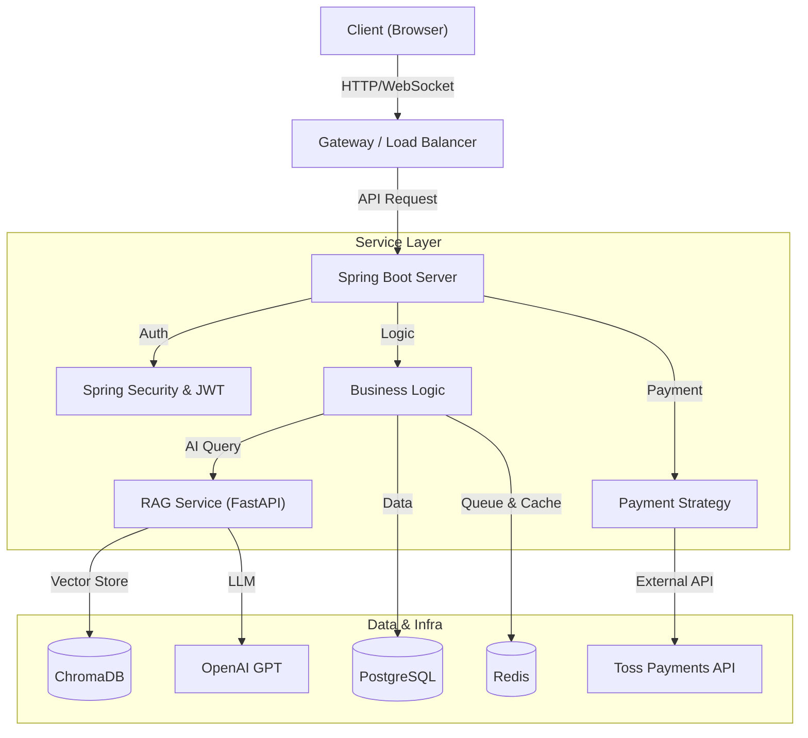
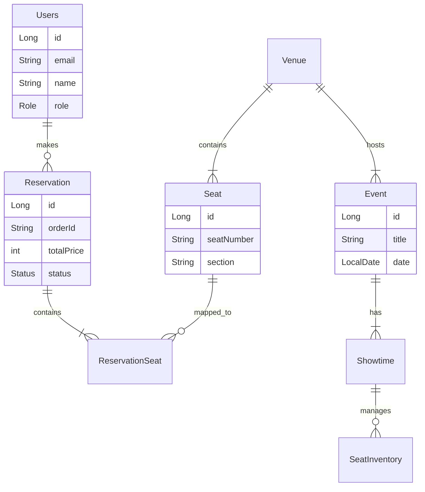

# Practice Shop

**Practice Shop**은 Spring Boot와 React를 기반으로 구축된 대규모 트래픽 처리를 위한 티켓팅 및 이커머스 실습 프로젝트입니다.
실제 서비스 환경을 모방하여 **대기열 시스템**, **실시간 좌석 선점**, **결제 시스템 연동**, **AI 기반 질의응답(RAG)** 등 고난이도 기능을 구현하였습니다.

---

## 🏗 아키텍처 (Architecture)

### 시스템 아키텍처


---

## 🛠 기술 스택 (Tech Stack)

| Category | Technology | Description |
| --- | --- | --- |
| **Backend** | **Java 17** | 주요 언어 |
| | **Spring Boot 3.5.7** | 웹 프레임워크 |
| | **Spring Data JPA** | ORM (Hibernate) |
| | **Spring Security** | 인증/인가 (JWT, OAuth2) |
| | **Redis** | 대기열 관리, 캐싱 |
| | **PostgreSQL** | 메인 데이터베이스 |
| | **Swagger (OpenAPI)** | API 문서화 |
| **Frontend** | **React 19** | UI 라이브러리 |
| | **Material UI v7** | UI 컴포넌트 |
| | **Zustand / Context** | 상태 관리 |
| | **SockJS & StompJS** | 실시간 통신 |
| **AI / RAG** | **FastAPI** | RAG 서비스 서버 |
| | **LangChain** | LLM 프레임워크 |
| | **ChromaDB** | 벡터 데이터베이스 |
| **Infra** | **Docker** | 컨테이너화 |
| | **Docker Compose** | 멀티 컨테이너 오케스트레이션 |
| | **PgAdmin** | DB 관리 도구 |

---

## ✨ 주요 기능 (Key Features)

### 1. 사용자 인증 (Authentication)
- **JWT 기반 인증**: Access Token & Refresh Token 전략 사용.
- **OAuth2 소셜 로그인**: Google 로그인 지원.
- **보안**: Password 암호화, Role 기반 권한 제어 (USER, ADMIN).

### 2. 🚦 대기열 시스템 (Queue System)
트래픽 폭주로 인한 서버 다운을 방지하기 위해 **Redis 기반의 대기열 시스템**을 도입했습니다.
- **진입 제어**: API 요청 전 대기열 토큰 발급.
- **순차 처리**:
    - `Active Queue`: 실제 트래픽을 처리하는 큐.
    - `Waiting Queue`: 대기 중인 유저 큐.
    - **Queue Worker**: `QueueWorker`가 주기적(2000ms)으로 `Waiting Queue`에서 일정 수량(Default 50)을 `Active Queue`로 승격시킵니다.
- **Poling**: 클라이언트에서 주기적으로 대기 순번 확인.

### 3. 예약 및 실시간 좌석 (Ticketing & Realtime Seats)
- **복잡한 예약 로직**: 공연 -> 회차 -> 구역 -> 좌석 선택 흐름.
- **실시간 동기화**: WebSocket(STOMP)을 이용하여 다른 유저가 좌석을 선택하면 **실시간으로 '선점됨' 상태 반영**.
- **동시성 제어**: 좌석 재고 조회 시 비관적 락(`SELECT ... FOR UPDATE`)으로 같은 좌석의 중복 예약 차단. 아래 [검증](#-검증-verification) 참고.

### 4. 결제 시스템 (Payment)
- **Strategy Pattern 적용**: 결제 수단(토스 페이먼츠 등) 추가에 유연한 구조로 리팩토링.
- **Toss Payments 연동**: 실제 결제 승인 및 취소 프로세스 구현.
- **트랜잭션 보장**: 결제 실패 또는 유저 취소 시 **자동 환불 및 좌석 점유 해제**.

### 5. 관리자 (Admin)
- **통합 마법사 (Wizard)**: 공연, 공연장, 회차를 한 번에 등록하는 올인원 페이지.
- **CMS**:
    - **공연 관리**: Event CRUD.
    - **공연장 관리**: Venue CRUD.
    - **회차 관리**: Showtime CRUD.
    - **좌석 관리**: 구역(Section) 및 좌석(Seat) 배치 관리.
    - **좌석 매퍼**: 시각적 좌석 배치 도구.
- **Batch Processing**: 대량의 좌석 데이터 일괄 생성 지원.

### 6. 검색 및 API 문서 (Search & Docs)
- **다양한 검색 조건**: 검색어(Keyword), 카테고리(Category)를 통한 정밀한 검색 지원.
- **Swagger UI**: `/swagger-ui.html`을 통해 API 명세 확인 및 테스트 가능.

### 7. 리뷰 및 평점 (Reviews & Ratings)
- **별점 시스템**: 1~5점 척도의 직관적인 별점 기능.
- **생생한 후기**: 공연 관람 후 상세한 텍스트 후기 작성 가능.
- **작성 자격 검증**: 로그인한 사용자만 리뷰 작성 가능 (향후 예매 내역 연동 예정).

### 8. 🤖 AI Assistant (RAG)
- **질의응답 시스템**: 프로젝트 관련 문서(매뉴얼, 정책 등)를 기반으로 사용자 질문에 답변.
- **Vector Search**: ChromaDB를 사용하여 관련성 높은 문서를 검색 후 GPT-3.5가 답변 생성.

---

## ✅ 검증 (Verification)

### 좌석 동시 예매 테스트
`SeatReservationConcurrencyTest`는 Testcontainers로 실제 PostgreSQL 15를 띄워서 실행합니다(Docker 필요). 100개 스레드가 같은 좌석을 동시에 예매합니다.

| 조건 | 성공한 예약 수 |
| --- | --- |
| 비관적 락 적용 (현재 코드) | **1건** (나머지 99건은 `SEAT_ALREADY_RESERVED`) |
| `@Lock` 제거 시 | **10건 중복 예약** (동시 진입 수가 커넥션 풀 크기 10에서 막힘) |

```bash
./gradlew test --tests '*SeatReservationConcurrencyTest'
```

### 대기열 진입 부하 테스트
`scripts/load_test_queue.py`로 측정했습니다. 동시 워커 100개, `POST /api/queue/enter` 응답시간만 쟀습니다.

| 가상 유저 | 실패 | p50 | p95 | max |
| --- | --- | --- | --- | --- |
| 200 | 0 | 9ms | 537ms | 568ms |
| 500 | 0 | 5ms | 349ms | 554ms |
| 1,000 | 0 | 4ms | 80ms | 853ms |
| 2,000 | 0 | 3ms | 15ms | 686ms |

> 측정 환경: 로컬 단일 머신(WSL2, 16코어). 서버와 부하 발생기가 같은 머신에서 돌았고, Redis 7과 Postgres 15는 Docker로 띄웠습니다. 200명 구간의 p95가 높은 건 JVM 워밍업 영향으로 보입니다. 운영 환경 수치가 아닙니다.

```bash
python3 scripts/load_test_queue.py --users 1000 --workers 100 --polls 1
```

---

## 🔧 트러블슈팅 (Troubleshooting)

### 결제 승인 중 취소되거나 좌석이 회수되면 돈만 빠져나가는 문제
**문제**
`confirmPayment`가 트랜잭션 하나 안에서 Toss 승인 API를 호출하고 있었습니다. 외부 승인과 DB 커밋은 하나로 묶을 수 없어서, 두 가지 경우에 돈은 빠져나갔는데 좌석이 남에게 다시 팔릴 수 있었습니다.
1. 승인은 성공했는데 그 뒤 커밋이 실패하는 경우: 예약이 `PENDING_PAYMENT`로 남고, 홀드 만료 스케줄러가 좌석을 회수합니다.
2. 승인 응답을 기다리는 동안 사용자가 예매를 취소하는 경우: 환불 없이 좌석만 풀립니다.

추가로, 외부 응답을 기다리는 동안 DB 커넥션을 계속 잡고 있었습니다.

**해결**
- `PENDING_CONFIRM` 상태를 새로 두고, **승인을 시도한다는 사실을 먼저 커밋한 뒤** 외부 API를 호출하게 바꿨습니다. 회수 스케줄러는 `PENDING_PAYMENT`만 대상으로 하기 때문에, 이후 어느 단계에서 죽더라도 좌석은 잠긴 채로 남습니다.
- `PENDING_CONFIRM` 상태인 예매를 취소하려 하면 `409 PAYMENT_CONFIRM_IN_PROGRESS`를 돌려줍니다.
- 실패를 원인에 따라 다르게 처리합니다.
  - Toss가 **명시적으로 거절**한 경우: 승인되지 않은 게 확실하므로 좌석을 바로 되돌립니다.
  - **타임아웃이나 네트워크 오류**인 경우: 승인됐는지 알 수 없으므로 좌석을 잠근 채로 둡니다. 결제됐을지 모르는 좌석을 다시 파는 것보다 묶어두는 쪽이 피해가 작다고 판단했습니다.
- 외부 호출을 트랜잭션 밖으로 빼서, 응답을 기다리는 동안 DB 커넥션을 잡고 있지 않게 했습니다.

**검증**
`HoldAndQueueGateTest`로 확인합니다: 승인 중인 예매는 취소가 거절되는지, 거절 응답이면 좌석이 복구되는지, 타임아웃이면 좌석이 유지되는지.

**남은 과제**
`PENDING_CONFIRM` 건을 자동으로 정리(대사)하는 기능이 없습니다. Toss 결제 조회 API로 이 상태의 건을 주기적으로 확정하거나 해제하는 스케줄러가 다음 단계입니다.

---

## 🗂 폴더 구조 (Project Structure)

핵심 비즈니스 로직이 위치한 `src` 디렉토리 구조입니다.

```text
src
├── main
│   ├── java
│   │   └── com.example.practice_shop
│   │       ├── config          # 설정 (Security, Swagger, WebSocket 등)
│   │       ├── constant        # Enums (Role, Status 등)
│   │       ├── controller      # API 엔드포인트
│   │       ├── dtos            # 데이터 전송 객체
│   │       ├── entity          # DB 엔티티 (JPA)
│   │       ├── exception       # 전역 예외 처리
│   │       ├── integration     # 외부 연동 (결제, RAG 등)
│   │       ├── repository      # DB 접근 계층
│   │       ├── security        # 인증/인가 (JWT, OAuth2 핸들러)
│   │       └── service         # 비즈니스 로직
│   └── resources
│       ├── static              # 정적 리소스
│       └── application.yml     # 설정 파일
└── test                        # JUnit & Mockito 테스트
```

---

## 💾 데이터베이스 설계 (ERD)

주요 엔티티 간의 관계도입니다.



---

## 🚀 시작하기 (Getting Started)

### 1. 환경 변수 설정 (.env)
프로젝트 루트에 `.env` 파일을 생성해주세요.

```properties
POSTGRES_USER=postgres
POSTGRES_PASSWORD=your_password
DB_URL=jdbc:postgresql://db:5432/shop
JWT_SECRET=your_secure_jwt_secret
GOOGLE_CLIENT_ID=your_client_id
GOOGLE_CLIENT_SECRET=your_client_secret
TOSS_SECRET_KEY=your_toss_payments_key

# RAG Service (Optional)
OPENAI_API_KEY=your_openai_api_key
```

### 2. 실행 (Docker Compose)
가장 간편한 실행 방법입니다. DB, Redis, App을 모두 실행합니다.
```bash
docker-compose up -d --build
```
- **Backend**: `http://localhost:8084`
- **Swagger UI**: `http://localhost:8084/swagger-ui.html`
- **PgAdmin**: `http://localhost:5050` (Email: `admin@local.com` / PW: `admin`)

### 3. 로컬 실행 (Manual)
**Backend**
```bash
./gradlew bootRun
```
**Frontend**
```bash
cd practice-shop-frontend
npm install && npm start
```
**RAG Service (Python)**
```bash
cd practice-shop-rag
pip install -r requirements.txt
python main.py
```
- **RAG API**: `http://localhost:8000/docs`

### 4. 대기열 부하 테스트 (Load Testing)
대기열 시스템의 성능을 검증하기 위한 Python 스크립트가 제공됩니다.
```bash
# 별도 의존성 없이 표준 라이브러리만으로 실행됩니다.
python3 scripts/load_test_queue.py --users 200 --event 1
```
- 다수의 쓰레드를 생성하여 대기열 진입(`enter`) 후 입장 가능(`ready`)까지 순번을 폴링하는 시나리오를 시뮬레이션합니다.
- 옵션: `--url`(기본 `http://localhost:8084`), `--users`, `--workers`, `--polls` 등. `--help`로 전체 확인.
